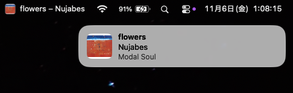

# Track Banner for Spotify

Shows a banner in the top-right corner of your macOS screen whenever the track changes in Spotify.
Unlike system notifications, the **album cover** takes the place of the app icon.

Album art comes from the Spotify oEmbed API, so no login is required.



## Install

```sh
brew install kongchu2/tap/track-banner
```

Or download the latest `TrackBanner-<version>.zip` from [Releases](https://github.com/kongchu2/track-banner/releases), unzip it, and move `TrackBanner.app` to `/Applications`.
The app is signed with Developer ID and notarized by Apple.

## Usage

From the banner-shaped icon in the menu bar you can turn on **Launch at Login**, turn banners off, choose to show the current track's **album cover**, **title**, or **artist** in the menu bar, hide the icon, or quit the app.
A hidden icon comes back when you open the app again.
Launch at Login remembers where the app was when you turned it on, so move the app to its final location first.

## Lyrics

Turn on **화면에 가사 띄우기** to keep the line being sung in a small floating panel, or **메뉴 막대에 가사 표시** to show it in the menu bar in place of the title and artist.
Both are off by default.

- The panel only appears while a line is being sung: it hides during instrumental breaks, while paused, and for tracks without synced lyrics.
- Drag the panel to move it; it remembers where you put it.
- With **마우스를 올리면 가사 숨기기** on, the panel hides while the pointer is over it and clicks go through to whatever is underneath. Hold ⌘ while moving onto it to drag it instead.
- **가사 배경** changes what is behind the lyrics: **투명** makes the glass see-through, so what is behind stays visible, **앨범 색** tints the panel with the cover's most prominent colour, and **앨범 커버** puts a blurred copy of the cover behind the lyrics. All three use white text.
- **발음 표기(로마자)** adds the pronunciation to the panel, either above the characters it belongs to (글자 위에) or as a line of its own below (가사 아래에): romaji for Japanese, pinyin for Chinese, and a Latin transliteration for other scripts (Korean is left alone). It uses the readings built into macOS, so nothing is downloaded, but unusual readings in Japanese lyrics can be wrong and Cantonese songs get Mandarin pinyin.
- **가사 번역** adds a translation under each line in the panel, in the language you pick (your system languages and English). It uses Apple's on-device translation, so the lyrics are not sent anywhere. Each language has to be downloaded once: when the current track needs one, the 가사 번역 menu offers **… 번역 언어 내려받기…**, which opens the system's download dialog (it also opens right after you pick a language, if the current track needs one). The translation appears once the download finishes. Needs macOS 15 or later, and translations are cached with the lyrics.
- Lyrics come from [LRCLIB](https://lrclib.net), which is sent the track's title, artist, album and length. They are cached in `~/Library/Application Support/TrackBanner/lyrics`.
- With the official Spotify client, the app asks Spotify for the playback position every 10 seconds to stay in step, so macOS asks once for permission to control Spotify.

### Spotify's own lyrics (optional)

LRCLIB does not have every track. Choose **Spotify 가사 로그인…** to sign in as a Spotify client (through [librespot](https://github.com/librespot-org/librespot), bundled as `lyrics-sidecar`) and approve it once in your browser.
The app then uses the lyrics Spotify's own apps show first and falls back to LRCLIB, and it follows Spotify Connect, so the lyrics keep up with seeks and pauses on any device as they happen.

This uses an undocumented Spotify endpoint through a real client login. It is a grey area under Spotify's terms, it stores reusable account credentials on disk (`~/Library/Application Support/TrackBanner/spotify`), and it can stop working whenever Spotify changes something.
Choose **Spotify 가사 로그아웃** to delete the credentials.

## Tracking other apps (Spotifast, web player, ...)

Only the official Spotify desktop client sends the track-change events this app listens to.
To follow playback from other apps, choose **Spotify 연결** in the menu and connect the Spotify Web API; the app then polls your currently playing track every 3 seconds (every 10 seconds while nothing is playing).

1. Create an app at [developer.spotify.com/dashboard](https://developer.spotify.com/dashboard), add `trackbanner://callback` as a Redirect URI, and select **Web API**.
2. Paste its Client ID into the dialog and approve the login in your browser.

Only the `user-read-currently-playing` scope is requested, and the refresh token is kept in your Keychain. Choose **Spotify 연결 해제** to remove it.

Lyrics for these apps follow the polled position, so they can be up to a second off and take a few seconds to catch up after a seek. Signing in for Spotify's own lyrics (above) removes that lag.

## Build & Run

Requires macOS 13 or later and Xcode (or a Swift toolchain).
[Rust](https://rustup.rs) is needed for `lyrics-sidecar`; without it the app is built without the Spotify lyrics sign-in and uses LRCLIB only.

```sh
./build.sh
open build/TrackBanner.app
```

`swift test` runs the lyrics parser and matching tests.

Move `build/TrackBanner.app` to `/Applications` before turning on Launch at Login.

## Behavior

- No banner for resuming after a pause, ads, or repeating the same track.
- The banner disappears after 2.5 seconds. Hovering keeps it on screen and shows a close button in the top-left corner.
- Clicking the banner brings Spotify to the front; the close button just dismisses it.
- Uses a Liquid Glass background on macOS 26 and a blurred background on earlier versions.
- The menu bar cover, title, and artist clear when playback stops, Spotify quits, or an ad plays. They stay while paused.
- With any of those menu bar options or a lyrics option on, the app asks Spotify for the current track when it launches, so macOS asks once for permission to control Spotify. With all of them off, it never asks.

If this overlaps with the official Spotify client's own notifications, turn off "Show desktop notifications when the song changes" in Spotify's settings.

## Release

1. Bump `CFBundleShortVersionString` and `CFBundleVersion` in `Info.plist`, then commit and push.
2. Run:

   ```sh
   scripts/release.sh
   ```

The script builds a Developer ID-signed, notarized, stapled `build/TrackBanner-<version>.zip` from a clean working tree.
After you confirm, it uploads a draft `v<version>` GitHub release and checks the uploaded file's SHA-256.
Then it publishes the release and updates `version` and `sha256` in [kongchu2/homebrew-tap](https://github.com/kongchu2/homebrew-tap).
Publishing also requires HEAD to match `origin/main` and the tag not to exist yet; these checks run before the build.

`scripts/release.sh --no-publish` only builds and notarizes, and works on any clean commit.

It needs a notarytool keychain profile named `trackbanner` (`xcrun notarytool store-credentials trackbanner ...`).

## License

[MIT](LICENSE)
